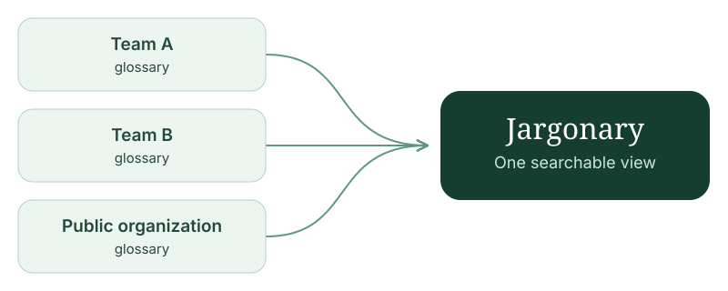

# Jargonary



**A glossary defines words in their context**—the meanings they have within a particular team, domain, or body of work. The same word can mean different things in different contexts.

Jargonary is a **distributed glossary**: each team owns and publishes its vocabulary, and a shared schema lets you bring those sources together into one searchable view. In the same company, a developer might use “API” to mean an application programming interface, while an engineer uses it to mean the American Petroleum Institute, which publishes industry standards. Both meanings belong in the glossary, with their context intact.

Jargonary provides a UI for browsing, searching, and linking to definitions in schema-defined data. Each team maintains its own terms and meanings, with context preserved when glossaries are brought together.

## Create a Glossary

The [glossary schema](docs-site/public/schema/v0.1.1/glossary.schema.json) gives teams a common format for terms, multiple meanings, aliases, and relationships—including abbreviations and replacements for deprecated terminology. Glossaries remain usable independently of this app.

A small glossary looks like this:

```yaml
# yaml-language-server: $schema=https://alampros.github.io/jargonary/schema/v0.1.1/glossary.schema.json
version: "1"
name: Payments
entries:
  - id: payment-intent
    term: Payment Intent
    senses:
      - id: payment-attempt
        definition: A record tracking a customer's attempt to pay.
```

Start with the [format guide](docs/dictionary-format.md) or the [example glossary](examples/terms/company.yaml). The [documentation site](https://alampros.github.io/jargonary/) includes getting-started guides, deployment and customization references, and versioned schema URLs for editor integration.

The [Web Development](examples/terms/web-development.yaml) and [Engineering](examples/terms/engineering.yaml) example glossaries both define **API**, **Component**, **Pipeline**, and **Port**, each in their team's context. The sample configuration and Docker Compose setup load both automatically alongside the company glossary.

## Configure Multiple Glossaries

Keep your glossary in a repository, mount it as a local file, or serve it over HTTP. Jargonary reads **JSON, YAML, and CSV** from local files or configured HTTP(S) URLs. Each team can use the workflow that suits it; the shared data contract connects them.

For HTTP publishing, we propose **`/.well-known/glossary`** as a conventional address. It is a project convention, not a registered standard, and any explicitly configured URL works. Sources are configured rather than automatically discovered across your network.

```yaml
sources:
  - id: payments
    url: https://payments.internal/.well-known/glossary
  - id: platform
    file: /terms/platform.yaml
```

Jargonary polls these sources, validates their data, and combines them for browsing and search while preserving source identities and distinct meanings. If a source goes offline, its last successful snapshot stays available.

Named exports at `/.well-known/glossary/{exportId}` publish schema-shaped glossaries filtered by source and publication tags. In v1, imported exports cannot themselves be re-exported. The app’s root `/.well-known/glossary` serves its own project glossary; sharing your teams’ content uses named exports. See the [publication guidance](docs/publishing.md).

## Run with Docker or a Binary

Jargonary ships as a **Docker container or standalone binary**, with its UI bundled and SQLite for storage. No separate database service, Go, or Node is needed at runtime.

Need TLS or a login screen? Let your reverse proxy earn its keep. User authentication and HTTPS termination belong in your proxy or hosting platform. Jargonary supports shared secrets for fetching protected sources and serving protected exports.

To try the sample glossary with Docker Compose:

```sh
docker compose up --build
```

Open [localhost:8080](http://localhost:8080/). Compose builds the image locally and mounts the sample vocabulary. SQLite runs in memory by default; set `database` to a file on persistent storage to retain cached snapshots across restarts.

To use a standalone binary, download one from [Releases](https://github.com/alampros/jargonary/releases), then run it with your configuration:

```sh
./jargonary -config /path/to/config.yaml
```

Use [examples/config.yaml](examples/config.yaml) as a starting point. See the [deployment reference](docs/reference.md#container) for mounts, persistence, and container configuration.

## Expose a Glossary to AI Agents

Jargonary can serve its glossaries over the [Model Context Protocol (MCP)](https://modelcontextprotocol.io) so AI agents can search and read them as read-only tools. It is off by default.

```yaml
mcp:
  enabled: true
  listen: 127.0.0.1:9091
```

This starts a separate, stateless listener on `mcp.listen`. It exposes tools for listing glossaries, searching definitions, reading entries and senses, browsing a source, and resolving a term's relationships to other terms. Tool arguments and results use source-qualified IDs.

The MCP listener is a new network surface with no built-in authentication. Bind it to a private interface or put it behind an authenticated proxy; do not publish it publicly.

See [Connect an AI agent](docs/mcp.md) for connection details and available tools.

## Customize Branding and Themes

Set `site_name` to your company name, choose an included theme, or add custom CSS and JavaScript without rebuilding the container. See [Branding and themes](docs/customization.md).

## Develop and Test

From source, with Go 1.27 and Node 26:

```sh
go tool task dev
```

Open [localhost:8080](http://localhost:8080/); Go rebuilds and React updates as you edit. Run the required checks before wrapping up changes:

```sh
go tool task check
```

See the [development reference](docs/development.md) and [project glossary](glossary/project.json) for more. Jargonary is MIT-licensed.
