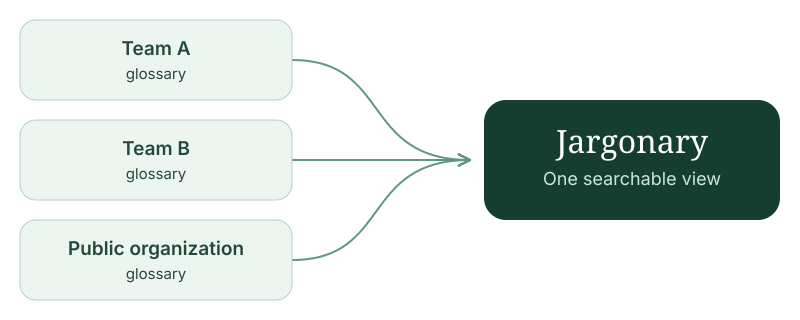

Jargonary combines team-owned glossaries into one searchable view. The same term can have different meanings across teams; source identities stay separate.

Run a standalone binary or container with bundled UI assets and SQLite. Teams edit and approve content in their own source systems.

- [Get started](getting-started.md)
- [Author a glossary](dictionary-format.md)
- [Configure and deploy](reference.md)
- [Connect an AI agent](mcp.md)
- [Customize branding](customization.md)

[Source](https://github.com/alampros/jargonary) · [Releases](https://github.com/alampros/jargonary/releases)
